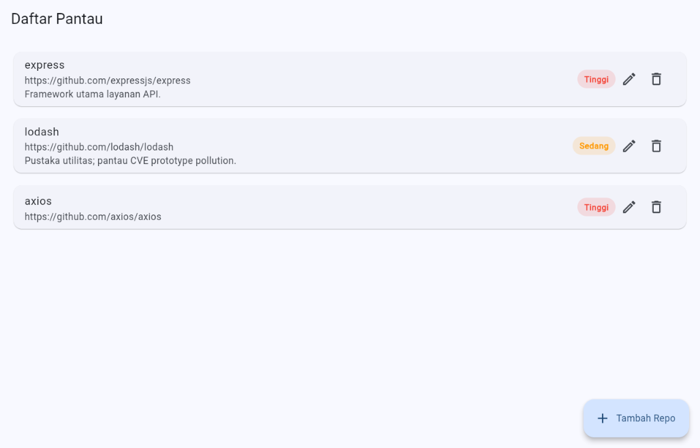
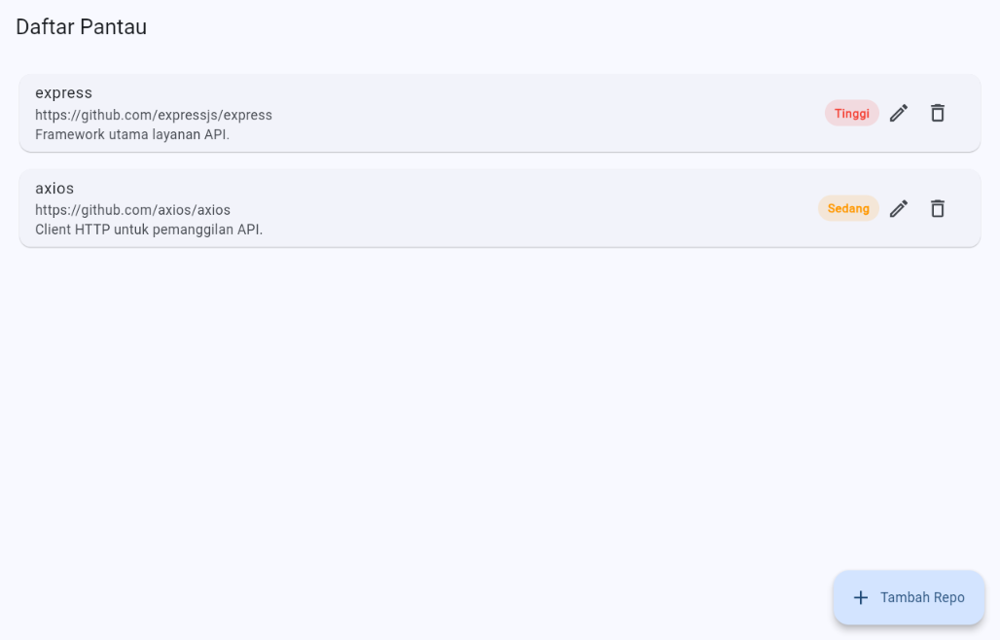

# P5 — Demo Local Data & Persistence: Daftar Pantau (Watchlist)

Dokumen ini menjelaskan fitur **Daftar Pantau** di Pulse, lokasi implementasinya, dan langkah demo yang bisa diikuti reviewer. Fitur ini memakai `shared_preferences` Flutter untuk menyimpan daftar repositori yang dipantau di perangkat/browser. Data fitur ini **tidak** dikirim ke backend Pulse maupun Firebase.

## Tujuan dan cakupan

Alur vertikal yang didemonstrasikan:

```
Form di UI
  → Provider (Riverpod)
  → WatchlistRepository
  → LocalWatchlistRepository
  → LocalStorageService
  → SharedPreferences perangkat/browser
```

Data daftar pantau tetap tersedia setelah aplikasi ditutup lalu dibuka kembali, atau setelah halaman web di-refresh, selama data situs/aplikasi tidak dihapus dan aplikasi dijalankan pada perangkat/browser serta origin yang sama.

Fitur ini berdiri sendiri: **tidak memerlukan backend untuk dijalankan**, sehingga cocok untuk demo persistence.

## Lokasi implementasi

| Bagian | File | Tanggung jawab |
| --- | --- | --- |
| Inisialisasi | `lib/main.dart` | Menyiapkan Flutter, `SharedPreferences`, repository, dan `ProviderScope` sebelum `runApp`. |
| Model/entity | `lib/models/watched_repository.dart` | Mendefinisikan `WatchedRepository` dan enum `WatchPriority`, termasuk konversi `toJson`/`fromJson`. |
| Validasi URL | `lib/services/repository_url.dart` | Fungsi murni `parseRepositoryUrl` dan `repositoryUrlError` untuk URL GitHub/GitLab. |
| Kontrak repository | `lib/services/watchlist_repository.dart` | Menetapkan operasi baca dan CRUD yang dipakai provider. Berisi juga `InMemoryWatchlistRepository` untuk tes UI. |
| Repository persisten | `lib/services/local_watchlist_repository.dart` | Memetakan model ke/dari penyimpanan lokal, menyediakan seed data awal, dan memvalidasi input. |
| Akses storage | `lib/services/local_storage_service.dart` | Menyimpan dan membaca collection sebagai daftar string JSON di `SharedPreferences`. |
| Provider data lokal | `lib/features/watchlist/application/watchlist_notifier.dart` | Memuat data dan menjalankan hapus, lalu memberi notifikasi UI. |
| Provider form | `lib/features/watchlist/application/watchlist_form_notifier.dart` | Menyimpan state form (validasi URL, status submit, error) untuk tambah/ubah. |
| Layar dan CRUD | `lib/features/watchlist/presentation/watchlist_screen.dart` | Menampilkan daftar, membuka form, memuat ulang data. |
| Form | `lib/features/watchlist/presentation/widgets/watchlist_form.dart` | Mengumpulkan URL, catatan, dan prioritas. |
| Kartu item | `lib/features/watchlist/presentation/widgets/watchlist_item.dart` | Menampilkan satu repositori, tombol ubah, dan hapus dengan konfirmasi. |
| Badge prioritas | `lib/features/watchlist/presentation/widgets/priority_badge.dart` | Menampilkan prioritas (Rendah/Sedang/Tinggi). |
| Routing | `lib/routes/app_router.dart`, `lib/features/project_management/presentation/project_list_screen.dart` | Rute `/watchlist` dan tombol masuk dari app bar "Proyek Saya". |
| Tes persistence | `test/services/local_watchlist_repository_test.dart` | Menguji CRUD dan membaca ulang data setelah repository dibuat ulang dengan preferences yang sama. |
| Tes UI CRUD | `test/features/watchlist/watchlist_screen_test.dart` | Menguji tambah, ubah, dan hapus repositori melalui UI. |

## Data model

### WatchedRepository

| Field | Tipe | Keterangan |
| --- | --- | --- |
| id | String | ID unik record. |
| repositoryUrl | String | URL repository GitHub/GitLab. |
| owner | String | Owner repositori, hasil parse URL. |
| repositoryName | String | Nama repositori, hasil parse URL. |
| note | String | Catatan bebas pengguna (boleh kosong). |
| priority | WatchPriority | Prioritas pemantauan: `low`, `medium`, `high`. |
| createdAt | DateTime | Waktu record dibuat (UTC). |
| updatedAt | DateTime | Waktu record terakhir diubah (UTC). |

`WatchPriority` ditampilkan dalam bahasa Indonesia: `low` → "Rendah", `medium` → "Sedang", `high` → "Tinggi".

## Bentuk penyimpanan

`LocalStorageService` mengubah model menjadi JSON, lalu menyimpan tiap collection sebagai `List<String>` di `SharedPreferences`.

| Key | Isi |
| --- | --- |
| `local_watched_repositories` | Repositori yang dipantau pengguna. |

Seed (dua repositori contoh: `express` dan `lodash`) diinisialisasi hanya jika key collection belum pernah ada. Menghapus semua record tidak menyebabkan seed dibuat ulang; seed hanya bisa muncul kembali jika collection dihapus lewat fungsi reset (mis. menghapus data situs/browser).

Catatan platform: pada Flutter web, `shared_preferences` menyimpan nilai di `localStorage` dengan prefiks `flutter.`, sehingga key sebenarnya adalah `flutter.local_watched_repositories`.

## Demo langkah demi langkah

### 1. Menjalankan aplikasi

Dari root project:

```bash
flutter pub get
flutter run -d chrome
```

Alternatif: jalankan di emulator/perangkat Flutter yang tersedia. Backend tidak perlu dijalankan untuk fitur ini. Jangan hapus data situs/browser selama demo persistence.

Masuk ke fitur ini dari app bar **Proyek Saya** → ikon **Daftar Pantau** (bookmark), atau langsung ke rute `/#/watchlist` pada Flutter web.

### 2. Create dan Read repositori

- Tekan **Tambah Repo**.
- Isi URL, mis. `https://github.com/axios/axios`, tambahkan catatan, pilih prioritas (mis. **Tinggi**).
- Tekan **Tambah ke Daftar**.
- Pastikan record baru tampil di daftar bersama seed `express` dan `lodash`.

### 3. Update

- Pada kartu repositori, tekan ikon **Ubah**.
- Ubah catatan dan/atau prioritas, lalu tekan **Simpan**. URL tidak dapat diubah.
- Pastikan nilai pada kartu berubah.

### 4. Delete

- Tekan ikon **Hapus**, lalu konfirmasi **Hapus** pada dialog.
- Pastikan kartu repositori tidak lagi tampil.

### 5. Membuktikan persistence setelah aplikasi dibuka kembali

- Pastikan tersisa minimal satu record (mis. hasil edit sebelumnya).
- Flutter web: refresh halaman dengan `Ctrl+R`/`F5`. Emulator/perangkat: tutup aplikasi lalu jalankan kembali.
- Buka lagi Daftar Pantau dan pastikan record yang belum dihapus tetap muncul dengan nilai hasil edit terakhir.

Data hanya berlaku untuk penyimpanan lokal yang sama. Origin berbeda (host/port berbeda), browser berbeda, perangkat berbeda, atau penghapusan data situs/aplikasi dapat menghasilkan penyimpanan terpisah atau menghapus record.

## Cara reviewer memeriksa implementasi

Urutan inspeksi kode yang disarankan:

1. Baca entity dan serialisasi di `lib/models/watched_repository.dart`.
2. Ikuti proses submit dari form di `lib/features/watchlist/presentation/widgets/watchlist_form.dart`.
3. Lihat state dan pemanggilan repository pada `lib/features/watchlist/application/watchlist_form_notifier.dart`.
4. Periksa operasi Create, Read, Update, Delete di `lib/services/local_watchlist_repository.dart`.
5. Periksa JSON dan `SharedPreferences` di `lib/services/local_storage_service.dart`.
6. Periksa tampilan baca/edit/hapus di `lib/features/watchlist/presentation/watchlist_screen.dart` dan `widgets/watchlist_item.dart`.
7. Jalankan tes persistence dan tes CRUD UI di bawah ini.

Untuk mendemonstrasikan langsung ke reviewer: tunjukkan satu record yang dibuat, ubah nilainya, hapus satu record, lalu refresh aplikasi dengan record lainnya masih tersimpan.

Validasi yang bisa dicoba: URL kosong, URL bukan GitHub/GitLab (mis. `https://evilgithub.com/a/b`), dan URL duplikat ditolak dengan pesan yang jelas. Akhiran `.git` dan garis miring di akhir diabaikan (mis. `https://github.com/foo/bar.git/` dianggap sama dengan `https://github.com/foo/bar`).

## Tes otomatis

Jalankan dari root project:

```bash
flutter test test/services/local_watchlist_repository_test.dart
flutter test test/features/watchlist/watchlist_screen_test.dart
flutter test
```

Tes repository menyimpan, memperbarui, dan menghapus record, lalu membuat repository baru dengan preferences yang sama dan membaca kembali record tersebut. Karena memakai `SharedPreferences` tiruan (`setMockInitialValues`), tes ini memverifikasi serialisasi/CRUD dan pembukaan ulang repository secara deterministik; tes ini **bukan** pengganti demo refresh browser nyata pada langkah 5.

Analisis statis project:

```bash
flutter analyze
```

Hasil yang didapat pada implementasi ini: `flutter analyze` → **No issues found!**, dan `flutter test` → **All tests passed! (31 test)**, termasuk 9 tes repository dan 5 tes UI Daftar Pantau.

## Bukti demo

Screenshot diambil dari aplikasi yang berjalan nyata (`flutter build web`, disajikan lokal, diakses di browser).

- Daftar setelah menambah `axios` (bersama seed `express` dan `lodash`):

  

- Setelah refresh halaman: `axios` (catatan + prioritas hasil edit) dan `express` tetap ada, `lodash` yang dihapus tidak muncul kembali:

  

Nilai mentah yang tersimpan di `localStorage` (`flutter.local_watched_repositories`) setelah refresh berisi `express` dan `axios`.

## Batasan yang perlu dijelaskan

- Penyimpanan yang didemonstrasikan adalah lokal dengan `shared_preferences`, sesuai pilihan storage untuk fitur ini.
- Data Daftar Pantau **tidak** dikirim ke backend Pulse, tidak disinkronkan ke cloud, dan tidak otomatis dibagikan ke pengguna/perangkat lain.
- `shared_preferences` sesuai untuk data sederhana berukuran kecil; untuk data kompleks atau besar, pertimbangkan SQLite/Isar.
- `InMemoryWatchlistRepository` dipertahankan untuk fake/test UI dan bukan storage persistence aplikasi utama.
